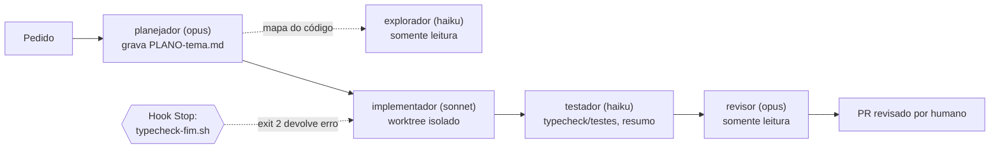

# claude-code-fluxo-agentes

🇧🇷 Português · [🇬🇧 English below](#english)

Template de configuração do **Claude Code** com um fluxo de subagentes por função (explorar → planejar → implementar → testar → revisar), um *hook* de typecheck no fim do turno e um guia de economia de tokens. É só configuração: não há aplicação aqui.

> **Transparência:** estes arquivos foram escritos com auxílio do Claude Code e revisados por mim. Eles derivam de uma configuração que usei num projeto real; removi tudo que era específico dele (framework, banco, nomes de branch, scripts de conferência). A cadeia completa de subagentes ainda **não foi validada de ponta a ponta**; veja Limitações.

## Problema

Sessões longas com um só modelo grande gastam tokens lendo código e rodando testes, e misturam planejar com implementar. A ideia é dar a cada etapa um agente com permissões e modelo mínimos adequados.

## Arquitetura



## Decisões técnicas

1. **Modelo e ferramentas por papel.** Quem só lê (explorador) recebe apenas `Read/Grep/Glob` e `haiku`. Revisor e planejador usam `opus`, onde o erro custa mais. O implementador roda com `isolation: worktree`, para nunca sujar a árvore principal.
2. **Plano em arquivo.** O planejador grava `PLANO-<tema>.md`; assim o plano sobrevive à sessão e pode ser revisado por um humano antes de gastar tokens implementando.
3. **Hook no `Stop`, não a cada edição.** O typecheck pode levar dezenas de segundos; roda uma vez no fim do turno, só se houver `.ts/.tsx` alterado e `node_modules` presente, e devolve o erro ao modelo com `exit 2`. Respeita `stop_hook_active` para não entrar em laço.
4. **Humano no ponto de decisão.** Nenhum agente abre ou mergeia PR; a revisão final é humana.
5. **MCP só no escopo do projeto** (`.mcp.json.example`), por causa do custo fixo de schema por sessão.

Veja o [guia de economia de tokens](docs/economia-de-tokens.md).

## Como usar

```bash
cp -r .claude /caminho/do/seu/projeto/          # agentes, hook e settings
cp CLAUDE.md.example /caminho/do/seu/projeto/CLAUDE.md   # edite
cp .mcp.json.example /caminho/do/seu/projeto/.mcp.json   # opcional
```

Abra o `claude` **dentro** da pasta do projeto: os agentes de projeto só carregam a partir de lá. Adapte os comandos de typecheck/teste nos agentes e no hook ao seu stack (o hook assume TypeScript com `npx tsc --noEmit`).

## Limitações conhecidas

- A cadeia completa de subagentes nunca foi executada de ponta a ponta no projeto de origem; só foram validados individualmente alguns passos e o hook.
- Num teste, os agentes de projeto não carregaram porque a sessão foi aberta fora da pasta do projeto (ver "Como usar").
- O hook é específico de TypeScript.
- Os números de custo do guia são medições de dias isolados, não um estudo controlado.

---

<a name="english"></a>
# claude-code-fluxo-agentes (English)

A **Claude Code** configuration template: role-based subagents (explore → plan → implement → test → review), an end-of-turn typecheck hook and a token-saving guide. Configuration only; there is no application here.

> **Disclosure:** these files were written with Claude Code's help and reviewed by me. They derive from a setup I used on a real project; everything project-specific was removed. The full subagent chain has **not been validated end to end**.

## Why

Long single-model sessions burn tokens on reading code and running tests and blur planning with implementing. Each stage gets an agent with minimal tools and a fitting model.

## Design

See the diagram above. Read-only agents get read-only tools and `haiku`; planner and reviewer use `opus`; the implementer runs in an isolated worktree. Plans are written to `PLANO-<topic>.md` so a human can review them before tokens are spent. A `Stop` hook runs the typecheck once at the end of a turn and returns errors to the model (`exit 2`), honouring `stop_hook_active`. No agent opens or merges PRs.

## Usage

Copy `.claude/` into your project, adapt the test/typecheck commands, and start `claude` from inside the project folder.

## Limitations

Chain not validated end to end; TypeScript-specific hook; cost figures are single-day measurements.

## License

MIT
